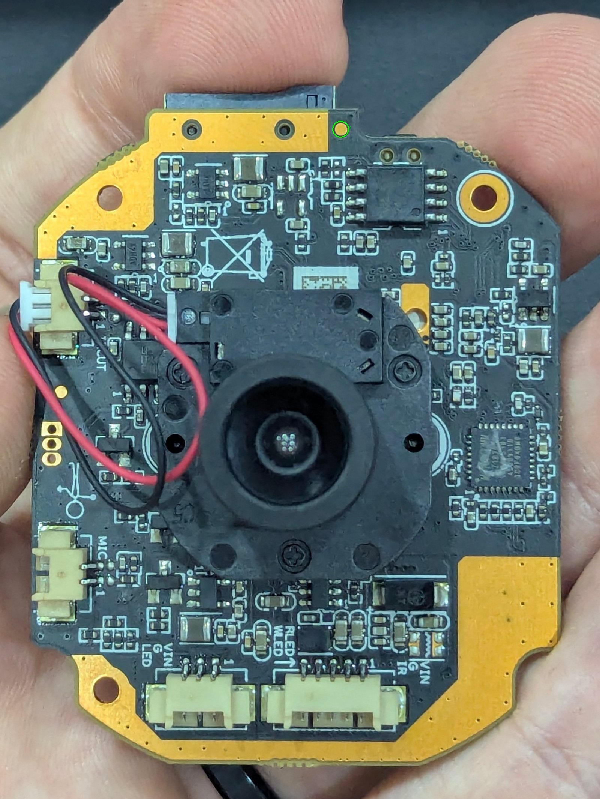
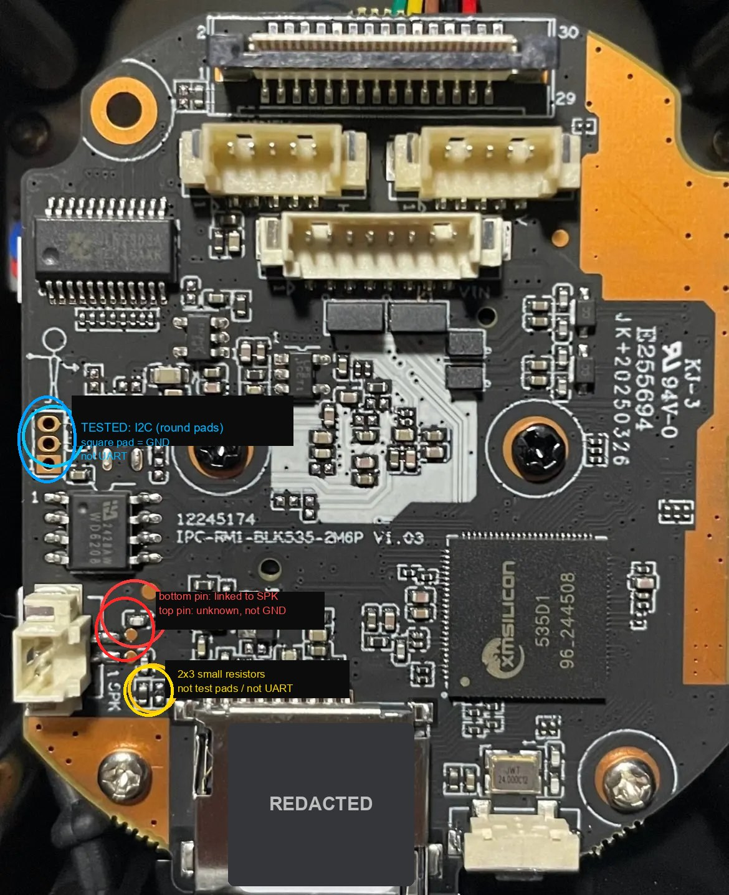
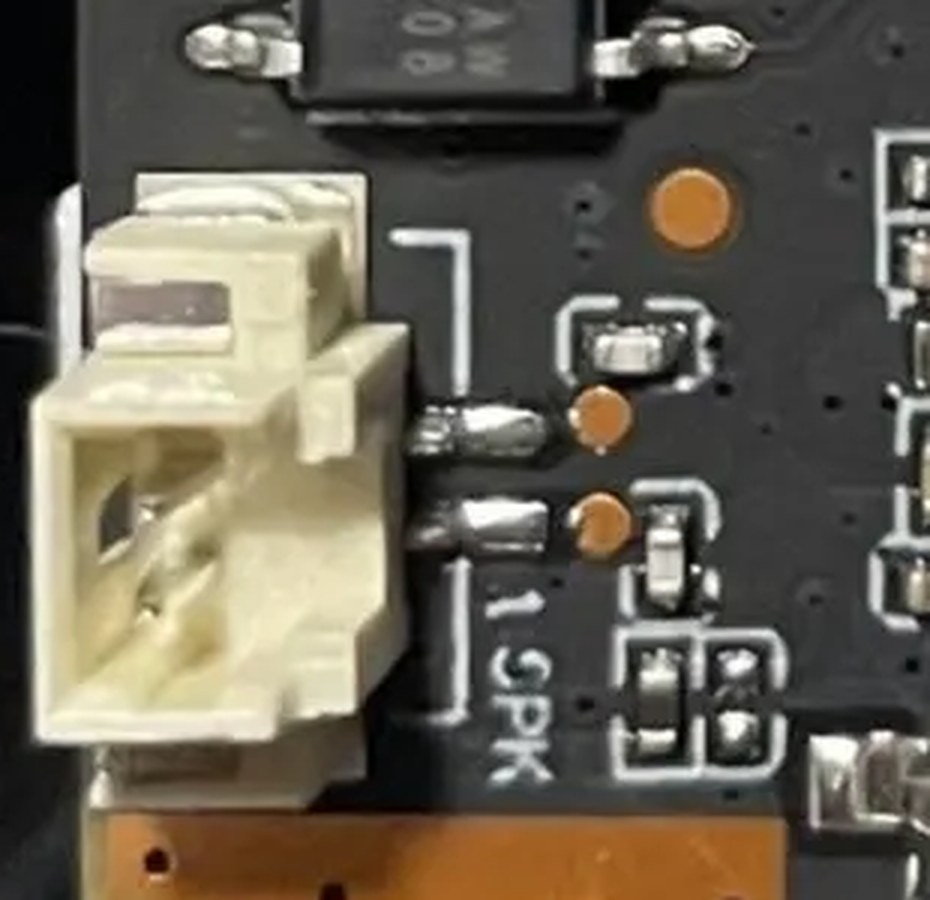

# Hardware photos and probed points — IPC-RM1-BLK535-2M6P V1.03

Photos of the project's own camera, published because the hardware discussion in these notes
refers to them. All are crops of the project's analysis set (source files from
`stack/analysis/uart/`, photographed **2026-11-18**), resized to a web-friendly size, stripped
of EXIF/GPS metadata, and with device-identifying labels redacted. No third-party or vendor
photos are used.

| field | value |
|---|---|
| Board | `IPC-RM1-BLK535-2M6P V1.03` (silkscreen), PCB date code `X-20240827` |
| SoC | Xiongmai **XM535D1** (QFN marking `XM535D1`, lot `96-244508`) |
| Flash | Fudan **FM25Q64A13**, 64 Mbit = 8 MiB, SPI NOR, **SOIC-8** (see [backup.md](backup.md)) |
| Photo dates | source photos 2026-11-18; published 2026-11-19 |
| License | own photos, same CC BY 4.0 as the rest of these notes |

> **UART was not found on this board revision.** The owner physically probed the points below:
> there is **no UART test pad** usable as a console. The three-pad group is I2C (square pad =
> GND), the red pair is the speaker/unknown, and the 2×3 cluster is a set of small resistors,
> not a test-pad grid. The console itself is known from the flash dump to be **ttyAMA0,
> 115200 8N1** (U-Boot 2014.04, `Password:` prompt), but no physical access point was
> identified. Use the SPI clip ([backup.md](backup.md)); the UART hunt is closed for this board.

## Board — lens side

The camera-module side: the 2 MP lens/IR-cut assembly on its bracket in the middle, a flex tail
at the top, and the peripheral harnesses at the bottom (`MIC`, `LED`, `IR`, `VIN`). The yellow
areas at the edges are flex stiffeners, not copper ground pour. Nothing on this side is
user-serviceable; the photo is here for reference and for locating the flash/SoC side.

## Board — SoC side

The same board, other side (the source photo is 180° rotated; it is turned upright here so the
silkscreen reads normally). Visible:

- **bottom right** — Xiongmai **XM535D1** SoC (QFN);
- **bottom left** — microSD slot and the `1 SPK` speaker connector;
- **top left** — `ULN2803A` stepper-motor driver (8-channel Darlington array);
- **top** — 30-pin FPC connector `J2` (pins `29`/`30` marked) and three JST peripheral connectors;
- **centre** — white thermal pad and the two board screws;
- **silkscreen** — `IPC-RM1-BLK535-2M6P V1.03`, `12245174` (PCB part number), and the PCB
  manufacturing code `KJ-3 E25694 94V-0 JK+20250326`.

## SoC close-up

The XM535D1 in the original package marking: `XM535D1` and lot `96-244508`. This is the only
readable chip marking on the board; there is no heat spreader and no shield can.

## SPI flash — not photographed

The flash is a **Fudan FM25Q64A13** (8 MiB, SOIC-8). It is *not* marked on the silkscreen, it is
not identifiable in the wide shots above, and this photo set has no readable close-up of it. The
dump/restore path uses a CH341A SOIC-8 clip ([backup.md](backup.md)), which does not need a photo.
We intentionally do **not** publish a crop that we cannot positively identify as the flash — a
mis-labelled "flash" photo would be worse than none.

## Points probed — no UART found

These are the points that were actually tested **by the owner**, with the resulting findings:

- **blue circle — 3-pad group at the left edge**: **I2C, not UART**. The square pad is **GND**;
  the two round pads are the I2C lines. Useful as a GND/3V3 reference only.
- **red circle — two filled pads right of the `1 SPK` connector**:
  - the **bottom pin is linked to the speaker**;
  - the **top pin is not GND**; its function is still unknown;
  - this pair is **not a UART RX/TX header**.
- **yellow circle — 2×3 cluster below/right**: these are **small resistors** on the PCB, **not
  test pads** and not a debug/programming grid.

There is no `UART`/`DBG`/`TX`/`RX` silkscreen anywhere on the board, and the owner found no
remaining UART test pad after probing. Consequently the physical UART route is **excluded** on
this revision; the recovery path is the SPI clip.

## Speaker connector area — close-up

Unannotated close-up of the `1 SPK` JST connector, the two filled pads (red group) and the 2×3
resistor cluster at the bottom right. This is the useful shot if the board is ever revisited,
but the findings above are the current, owner-verified state: **no UART here**.

## What was redacted, and what was left out

**Redacted:** the white QR sticker on the microSD-card shield and its text label
`IPG-X6EC-WEQ / JSPL20250328-13`, which encode the model and production/batch data of the
individual unit. Both are replaced by a grey `REDACTED` block. No MAC address, serial number,
Wi-Fi credential, account data or other QR code appears in the published crops; the only
remaining text is board silkscreen and PCB manufacturing codes, which are not unit-specific.

**Metadata:** all published JPEGs are re-encoded from the source pixels — EXIF, GPS, device/model
tags and embedded thumbnails are gone (verified: zero EXIF bytes). Source photos are 1777×2360;
published crops are ≤ 1600 px wide.

**Excluded:**

- third-party photos that are not this board: the OpenIPC-wiki sibling
  `IPC-RM1-BLK7202V3-M3A-WiFi` board shots and an external photo of a different Xiongmai board
  (`IPC-RB-BLK530AI-0235P-ABQ`). They are useful for comparison only, and their
  provenance/licence is unclear;
- UI/desktop and console screenshots from the analysis session — not hardware;
- any image whose identifying label could not be fully and cleanly redacted.

## File index

| file | source (crop from) | what it shows |
|---|---|---|
| `images/ipc-rm1-board-lens-side.jpg` | `uart/front_candidates.png` | full board, lens side (1600×2130) |
| `images/ipc-rm1-board-soc-side.jpg` | `uart/back_candidates.png` | full board, SoC side, turned upright (1510×2070) |
| `images/ipc-rm1-soc-xm535d1.jpg` | `uart/n_soc_area.png` | XM535D1 package marking (1080×1080) |
| `images/ipc-rm1-probed-points-annotated.jpg` | `uart/uart_candidates.png` | owner-probed points, corrected labels, QR redacted (1170×1437) |
| `images/ipc-rm1-spk-probed-points.jpg` | `uart/n_bottom_left.png` | SPK connector + probed points, unannotated (930×900) |

Total image payload: ~1.4 MB.
