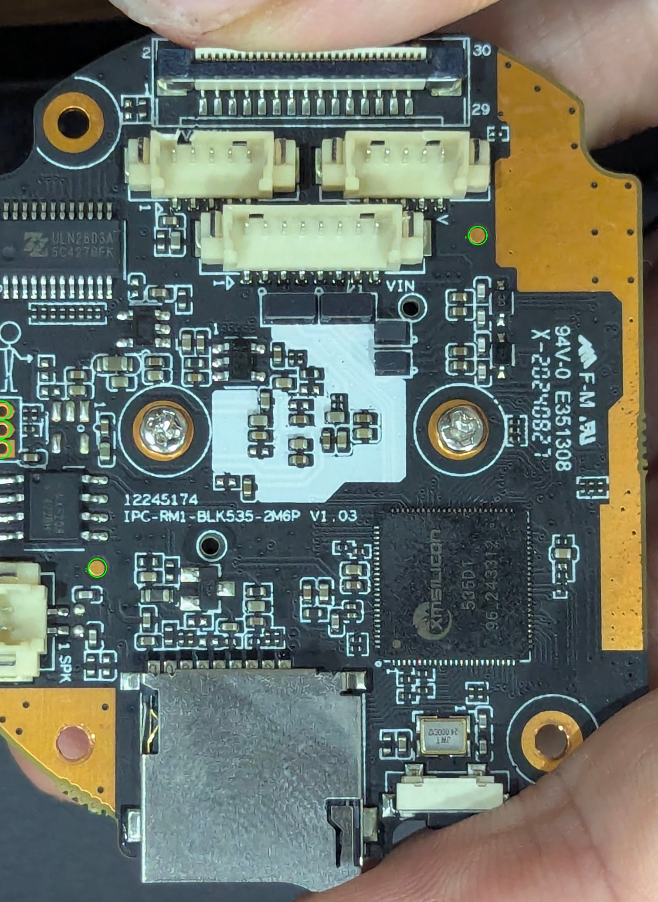
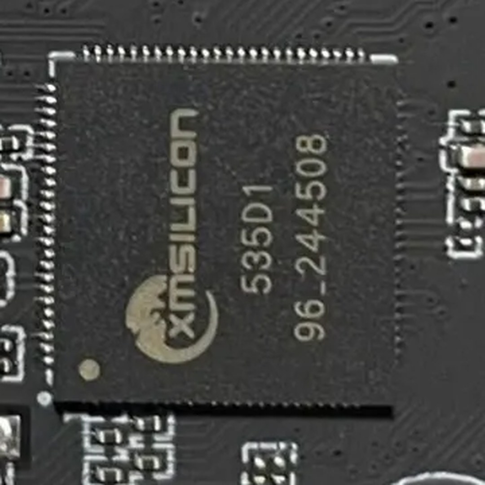
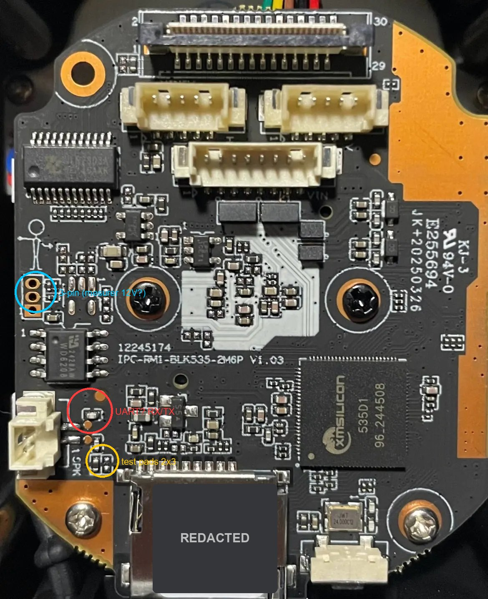

# Hardware photos — IPC-RM1-BLK535-2M6P V1.03

Photos of the project's own camera, published because the UART/SPI/pinout discussion in
other notes refers to them. All are crops of the project's analysis set (source files from
`stack/analysis/uart/`, photographed **2026-11-18**), resized to a web-friendly size, stripped
of EXIF/GPS metadata, and with device-identifying labels redacted. No third-party or vendor
photos are used.

| field | value |
|---|---|
| Board | `IPC-RM1-BLK535-2M6P V1.03` (silkscreen), PCB date code `X-20240827` |
| SoC | Xiongmai **XM535D1** (QFN marking `XM535D1`, lot `96-244508`) |
| Flash | Fudan **FM25Q64A13**, 64 Mbit = 8 MiB, SPI NOR, **SOIC-8** (see [backup.md](backup.md)) |
| Photo dates | source photos 2026-11-18; published 2026-11-19 |
| License | own photos, same CC BY 4.0 as the rest of these notes |

> **UART is unconfirmed.** No TX/RX pad has been identified on this revision, and there is no
> `UART`/`DBG`/`TX`/`RX` silkscreen anywhere on the board. The "candidates" below are
> *unverified* pad groups only — do not assume any of them is the console. The console itself is
> known from the flash dump to be **ttyAMA0, 115200 8N1** (U-Boot 2014.04, `Password:` prompt),
> but it was never reached physically.

## Board — lens side

The camera-module side: the 2 MP lens/IR-cut assembly on its bracket in the middle, a flex tail
at the top, and the peripheral harnesses at the bottom (`MIC`, `LED`, `IR`, `VIN`). The yellow
areas at the edges are flex stiffeners, not copper ground pour. Nothing on this side is
user-serviceable; the photo is here for reference and for locating the flash/SoC side.

## Board — SoC side

The same board, other side (the source photo is 180° rotated; it is turned upright here so the
silkscreen reads normally). Visible:

- **bottom right** — Xiongmai **XM535D1** SoC (QFN);
- **bottom left** — microSD slot and the `1 SPK` speaker connector;
- **top left** — `ULN2803A` stepper-motor driver (8-channel Darlington array);
- **top** — 30-pin FPC connector `J2` (pins `29`/`30` marked) and three JST peripheral connectors;
- **centre** — white thermal pad and the two board screws;
- **silkscreen** — `IPC-RM1-BLK535-2M6P V1.03`, `12245174` (PCB part number), and the PCB
  manufacturing code `KJ-3 E25694 94V-0 JK+20250326`.

## SoC close-up

The XM535D1 in the original package marking: `XM535D1` and lot `96-244508`. This is the only
readable chip marking on the board; there is no heat spreader and no shield can.

## SPI flash — not photographed

The flash is a **Fudan FM25Q64A13** (8 MiB, SOIC-8). It is *not* marked on the silkscreen, it is
not identifiable in the wide shots above, and this photo set has no readable close-up of it. The
dump/restore path uses a CH341A SOIC-8 clip ([backup.md](backup.md)), which does not need a photo.
We intentionally do **not** publish a crop that we cannot positively identify as the flash — a
mis-labelled "flash" photo would be worse than none.

## UART / test-pad candidates — annotated (unconfirmed)

Close-up of the SoC side with the two remaining candidate pad groups. **Neither is confirmed UART.**

- **red circle — "UART? RX/TX"**: two round, orange-filled pads (~1 mm, ~2 mm apart) immediately
  right of the `1 SPK` connector, with 0402 parts and 0-ohm-looking links beside them. This is the
  geometry the OpenIPC sibling board calls a 2-pad UART — but on this revision the pads look tied
  to the speaker port, so this may simply be speaker output. Unconfirmed.
- **yellow circle — "test pads 2x3"**: a 2×3 (6-pad) bare-pad cluster, pitch ~1.27 mm, a few mm
  below/right of the red candidate. Likely a factory debug/programming grid (could be
  TX/RX/GND/3V3 + BOOT/RESET), but unpopulated and untraced. Unconfirmed.
- **cyan circle — "3-pin (header 12V?)"**: left-edge square + 2 round pads. Already characterised
  as GND + two 3.3 V lines / I2C-like — **not UART**; useful only as a GND/3V3 reference for a meter.

## SPK connector + candidate pads close-up

Unannotated close-up of the same area: the `1 SPK` JST connector, the two stacked round pads
(red candidate), and the 2×3 bare-pad cluster (yellow candidate) at the bottom right. This is the
most useful shot for anyone who wants to continue the UART hunt with a multimeter or a scope.

If the pads are ever probed: camera off, check continuity to the known GND pad first; camera on,
the UART candidates should idle at ~3.3 V with no pull-up to 3V3 and one of them should show
115200 baud boot activity at power-on. See [backup.md](backup.md) and [telnet.md](telnet.md) for
the console facts (U-Boot password `#Ux6@9V&4_Rz`, ttyAMA0).

## What was redacted, and what was left out

**Redacted:** the white QR sticker on the microSD-card shield (visible at the bottom of the
annotated close-up) and its text label `IPG-X6EC-WEQ / JSPL20250328-13`, which encode the model
and production/batch data of the individual unit. Both are replaced by a grey `REDACTED` block.
No MAC address, serial number, Wi-Fi credential, account data or other QR code appears in the
published crops; the only remaining text is board silkscreen and PCB manufacturing codes, which
are not unit-specific.

**Metadata:** all published JPEGs are re-encoded from the source pixels — EXIF, GPS, device/model
tags and embedded thumbnails are gone (verified: zero EXIF bytes). Source photos are 1777×2360;
published crops are ≤ 1600 px wide.

**Excluded:**

- third-party photos that are not this board: the OpenIPC-wiki sibling `IPC-RM1-BLK7202V3-M3A-WiFi`
  board shots and an external photo of a different Xiongmai board (`IPC-RB-BLK530AI-0235P-ABQ`).
  They are useful for comparison only, and their provenance/licence is unclear;
- UI/desktop and console screenshots from the analysis session — not hardware;
- any image whose identifying label could not be fully and cleanly redacted.

## File index

| file | source (crop from) | what it shows |
|---|---|---|
| `images/ipc-rm1-board-lens-side.jpg` | `uart/front_candidates.png` | full board, lens side (1600×2130) |
| `images/ipc-rm1-board-soc-side.jpg` | `uart/back_candidates.png` | full board, SoC side, turned upright (1510×2070) |
| `images/ipc-rm1-soc-xm535d1.jpg` | `uart/n_soc_area.png` | XM535D1 package marking (1080×1080) |
| `images/ipc-rm1-uart-candidates-annotated.jpg` | `uart/uart_candidates.png` | annotated UART candidates, QR redacted (1170×1437) |
| `images/ipc-rm1-spk-uart-pads.jpg` | `uart/n_bottom_left.png` | SPK connector + candidate pads, unannotated (930×900) |

Total image payload: ~1.4 MB.
