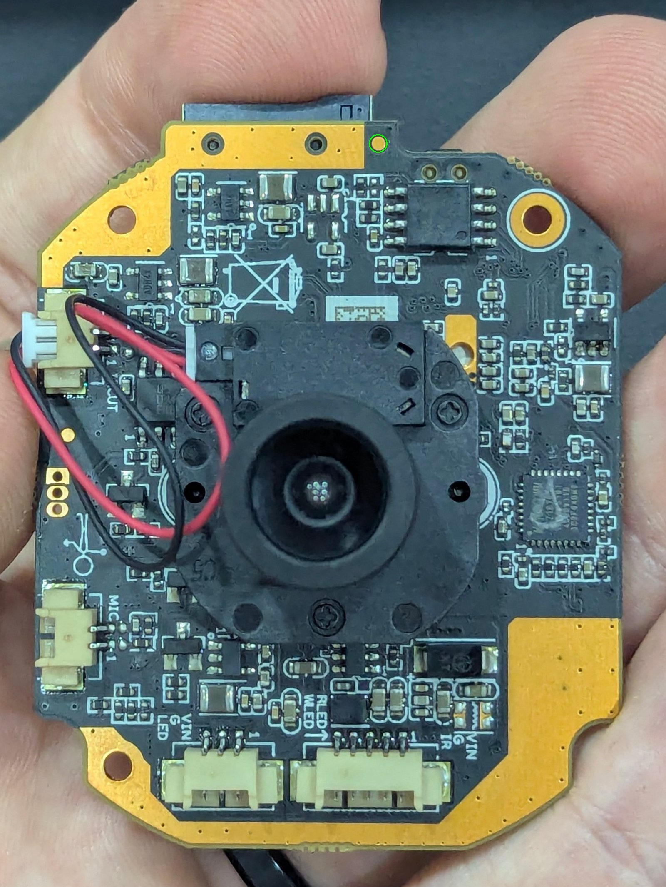
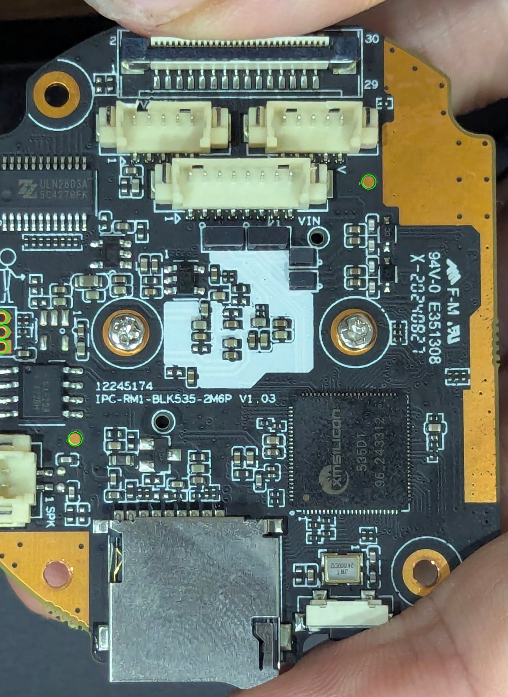
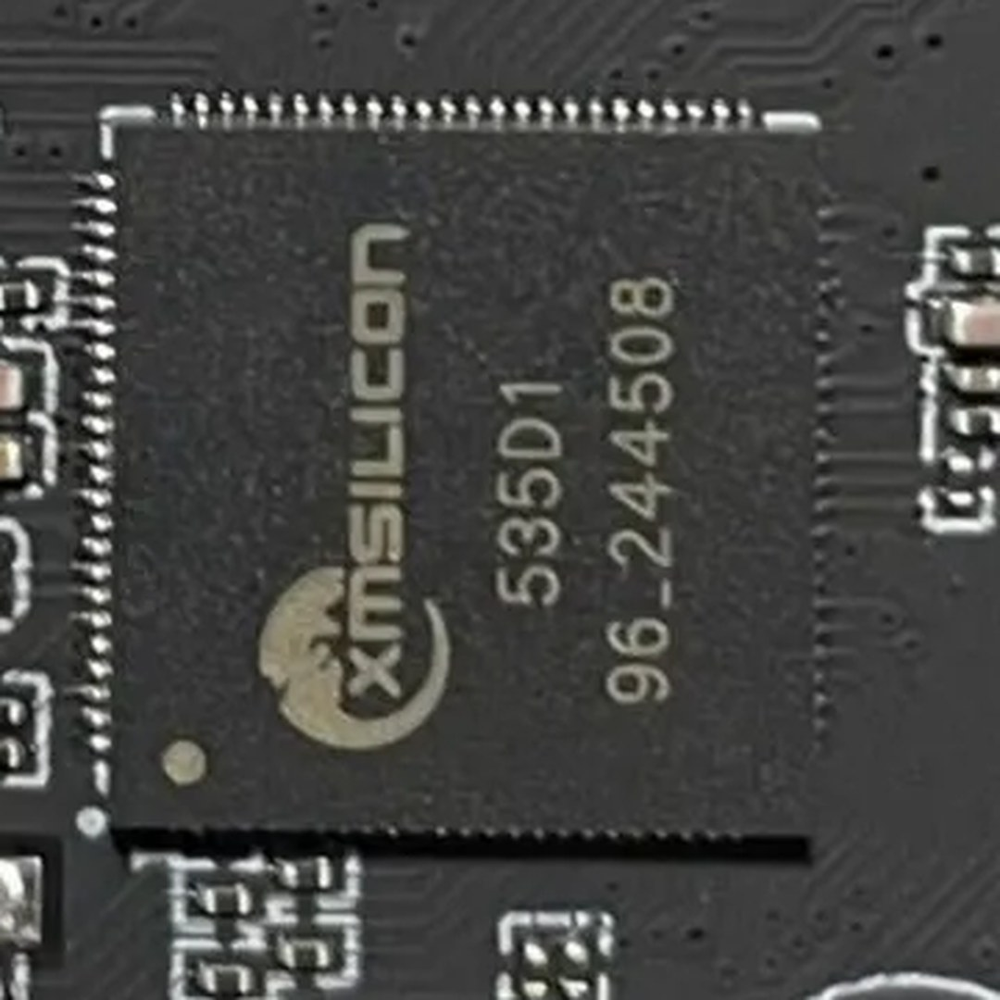
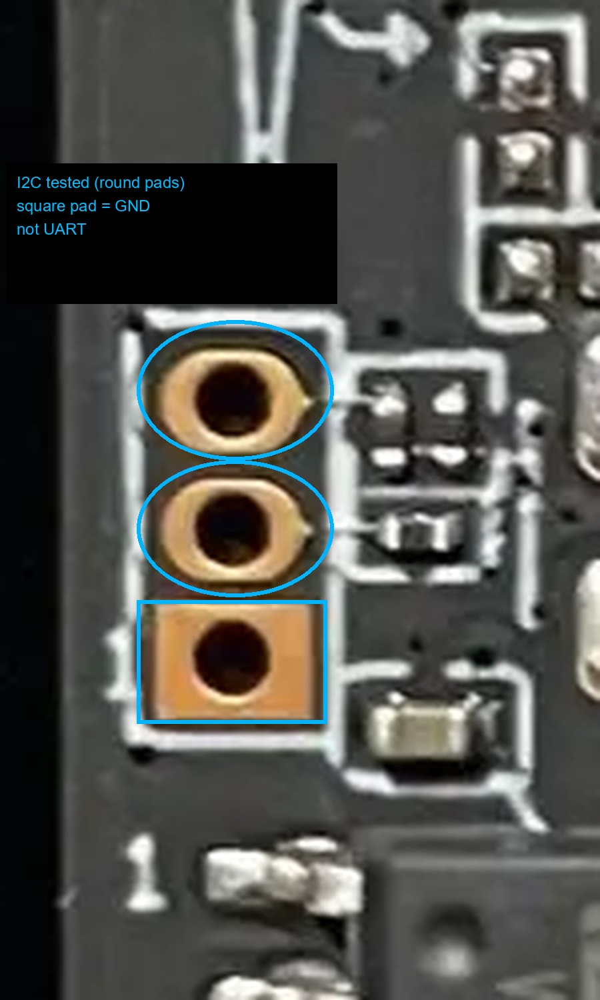
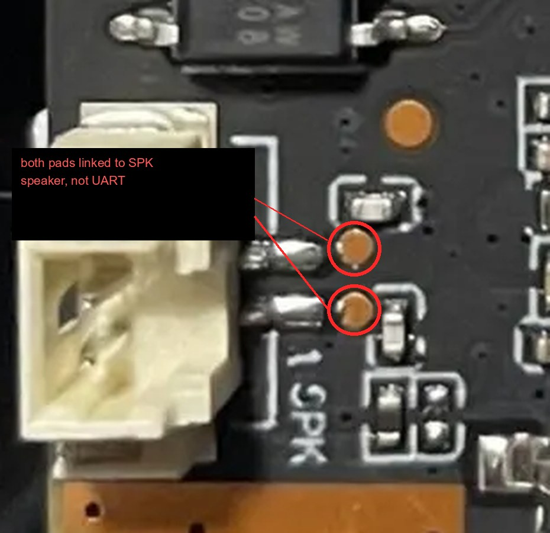
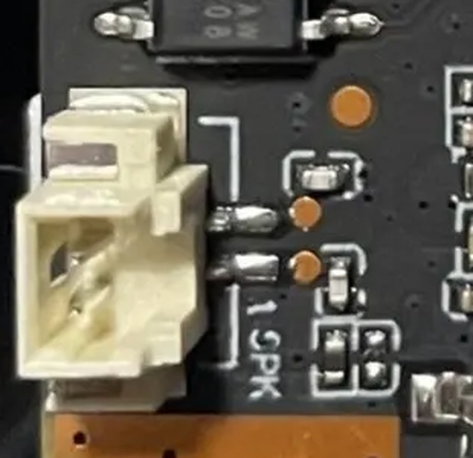

# Hardware

The `IPC-RM1-BLK535-2M6P V1.03` board with the Xiongmai XM535D1 SoC: components, photos,
probed points and the canonical 8 MiB SPI flash layout.

## Board

| Field | Value |
|---|---|
| Board | `IPC-RM1-BLK535-2M6P V1.03` (silkscreen), PCB part number `12245174` |
| SoC | Xiongmai **XM535D1** (QFN; dual-core 32-bit, Cortex-A5 class, H.265) |
| Model string | `XM535_X6E-WEQ_8M` (ONVIF `GetDeviceInformation`) |
| Flash | Fudan **FM25Q64A13**, 64 Mbit = 8 MiB, SPI NOR, SOIC-8, 3.3 V |
| Wi-Fi | `atbm6012b` (from the package `InstallDesc`) |
| Lens / sensor | two-sensor head (`SupportGunBallTwoSensorCamera`); board suffix `2M6P`; main stream 2304×2592 ([firmware.md](firmware.md#rtsp)) |
| PTZ | 2 stepper motors, `ULN2803A` driver (8-channel Darlington array) |
| Storage | microSD slot |
| Bootloader | U-Boot 2014.04 with a `Password:` prompt |
| Console | kernel console `ttyAMA0`, 115200 8N1 (from bootargs); no physical access point |

Firmware, stock services and ports: [firmware.md](firmware.md).

## UART: not available

No usable UART pad exists on this board revision (**HW**, all headers probed by the owner):

- the left-edge 3-pad group is I2C (square pad = GND, round pads = SDA/SCL); usable only as a
  GND/3V3 reference;
- the two red-marked pads right of `1 SPK` are both wired to the speaker;
- the 2×3 cluster next to them is a set of resistors, not test pads;
- no `UART`, `DBG`, `TX` or `RX` silkscreen exists on the board.

The rootfs `/etc/inittab` starts a getty on `ttyS000`; that is userspace and unreachable without
UART. Low-level access is the SPI clip only ([recovery.md](recovery.md)). Abandoned console
routes: [negative-results.md](negative-results.md).

## Photos

Photos of one fleet unit. EXIF/GPS removed; the unit QR sticker and its label are redacted.

### Lens side

The lens/IR-cut assembly on its bracket, a flex tail at the top, and the peripheral
harnesses at the bottom (`MIC`, `LED`, `IR`, `VIN`). Yellow edge areas are flex stiffeners.
Nothing on this side is user-serviceable.

### SoC side

Turned upright so the silkscreen reads normally:

- bottom right: XM535D1 SoC (QFN, no heat spreader, no shield can);
- bottom left: microSD slot and the `1 SPK` speaker connector;
- top left: `ULN2803A` stepper-motor driver;
- top: 30-pin FPC connector `J2` (pins `29`/`30` marked) and three JST peripheral connectors;
- centre: white thermal pad and the two board screws.

### SoC close-up

The `XM535D1` marking is the only readable chip marking on the board.

The SPI flash is not photographed: it is not marked on the silkscreen and is not identifiable in
these shots. The CH341A SOIC-8 clip procedure does not need a photo.

### Left-edge 3-pad group (I2C)

Square pad = GND; the two round pads = I2C lines.

### Speaker pads

Both filled pads right of `1 SPK` are speaker connections. The 2×3 parts below are resistors.

Same area, unannotated: the `1 SPK` JST connector, the two filled pads and the 2×3 resistor
cluster.

## SPI flash layout

8 MiB, from the vendor U-Boot environment:
`mtdparts=xm_sfc:256K,1536K,1280K,4544K,256K,320K`.

| MTD | Offset | Size | Name | Content | Package file |
|---|---|---|---|---|---|
| `mtd0` | `0x000000` | 256 KiB | `boot` | raw U-Boot; environment (64 KiB) at `0x30000` | `u-boot.bin.img`, `u-boot.env.img` |
| `mtd1` | `0x040000` | 1536 KiB | `kernel` | kernel uImage | `uImage.img` |
| `mtd2` | `0x1C0000` | 1280 KiB | `romfs` | CRAMFS rootfs `/` (BusyBox, init scripts) | `romfs-x.cramfs.img` |
| `mtd3` | `0x300000` | 4544 KiB | `user` | SquashFS 4.0 (xz) `/usr` (application, web UI, voice prompts) | `user-x.cramfs.img` |
| `mtd4` | `0x770000` | 256 KiB | `custom` | CRAMFS `/mnt/custom` (vendor customisation) | `custom-x.cramfs.img` |
| `mtd5` | `0x7B0000` | 320 KiB | `mtd` | JFFS2 `/mnt/mtd` (writable config, logs, accounts) | not shipped |

Notes:

- The unit identity block sits at `0x2FC00` in `mtd0`, just below the U-Boot environment. A
  reconstructed image has no identity; only a dump of the unit preserves it.
- The U-Boot environment is a standard `crc32 + "k=v\0…"` block. In **QEMU**, kernel console
  output appeared with `xmuart=0` in the environment and stayed hidden when the key was absent;
  the meaning of the value was not confirmed from the U-Boot or kernel code. `telnetctrl=1`
  starts the vendor debug service ([debug-services.md](debug-services.md)).
- `mtd5` is not part of the official package; the camera formats it on first boot.
- The `user` partition is SquashFS despite the `cramfs` file name.

Dump, restore and recovery images: [recovery.md](recovery.md).
